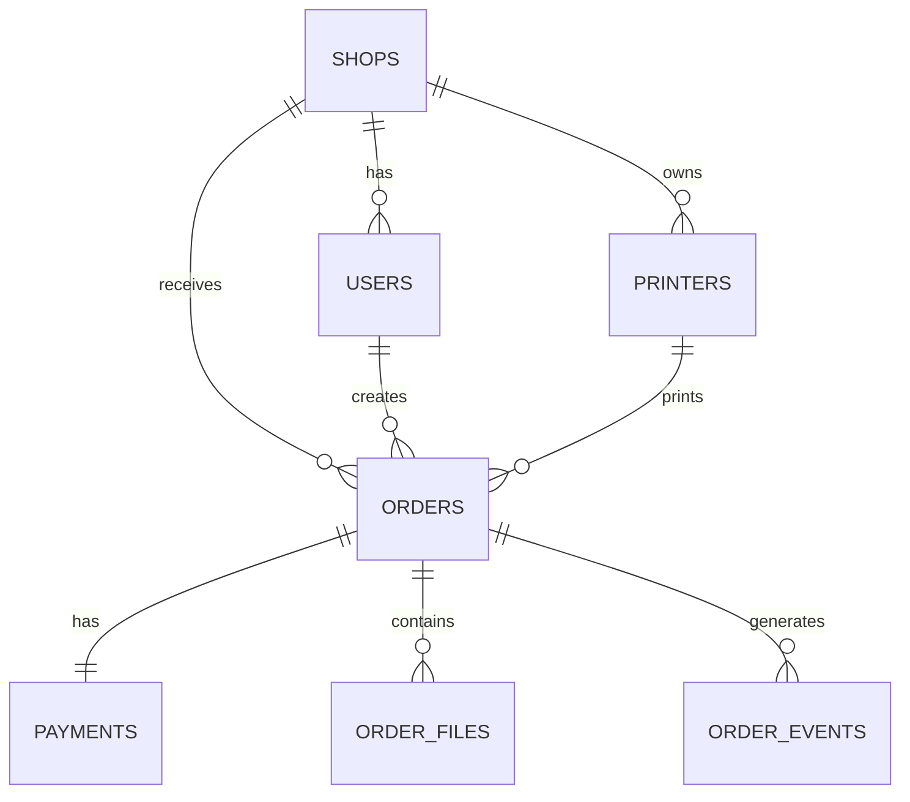

# Database Design

Project: Velox

Version: 1.0

Database: PostgreSQL

---

# Purpose

This document defines the database architecture for Velox.

It specifies:

- Tables
- Relationships
- Constraints
- Indexes
- Naming conventions
- Data lifecycle
- Future scalability

---

# Database Principles

• UUID primary keys

• Soft delete where appropriate

• Timestamps on every table

• Normalized schema

• Foreign key constraints

• Indexed search fields

---

# Database Overview



---

# Table Naming Convention

Use plural table names.

Correct

shops

orders

users

payments

Wrong

shop

Order

tbl_users

---

# Common Fields

Every table contains:

```sql
id UUID PRIMARY KEY

created_at TIMESTAMP

updated_at TIMESTAMP
```

---

# Table: shops

Stores every registered shop.

Fields

| Field | Type |
|--------|------|
| id | UUID |
| name | TEXT |
| qr_code | TEXT |
| address | TEXT |
| phone | TEXT |
| email | TEXT |
| status | TEXT |
| created_at | TIMESTAMP |
| updated_at | TIMESTAMP |

---

# Table: users

Stores customers and operators.

Fields

| Field | Type |
|--------|------|
| id | UUID |
| shop_id | UUID |
| name | TEXT |
| email | TEXT |
| phone | TEXT |
| role | TEXT |
| password_hash | TEXT |
| created_at | TIMESTAMP |
| updated_at | TIMESTAMP |

Roles

Customer

Operator

Owner

Admin

---

# Table: printers

Fields

| Field | Type |
|--------|------|
| id | UUID |
| shop_id | UUID |
| name | TEXT |
| printer_type | TEXT |
| status | TEXT |
| ip_address | TEXT |
| pages_per_minute | INTEGER |
| created_at | TIMESTAMP |

Printer Types

BlackWhite

Color

Bulk

Status

Online

Offline

Printing

Paused

---

# Table: orders

Core table.

Fields

| Field | Type |
|--------|------|
| id | UUID |
| order_code | TEXT |
| user_id | UUID |
| shop_id | UUID |
| printer_id | UUID |
| queue_position | INTEGER |
| total_pages | INTEGER |
| total_price | DECIMAL |
| payment_status | TEXT |
| order_status | TEXT |
| estimated_time | INTEGER |
| created_at | TIMESTAMP |

Order Status

Pending

Waiting

Accepted

Printing

Completed

Collected

Cancelled

Deleted

---

# Table: order_files

Fields

| Field | Type |
|--------|------|
| id | UUID |
| order_id | UUID |
| filename | TEXT |
| file_url | TEXT |
| page_count | INTEGER |
| size | BIGINT |
| mime_type | TEXT |
| delete_after | TIMESTAMP |

Files automatically removed after printing.

---

# Table: payments

Fields

| Field | Type |
|--------|------|
| id | UUID |
| order_id | UUID |
| method | TEXT |
| amount | DECIMAL |
| transaction_id | TEXT |
| status | TEXT |
| created_at | TIMESTAMP |

Methods

UPI

Counter

Card

Status

Pending

Success

Failed

Refunded

---

# Table: transactions

Stores financial history.

Fields

| Field | Type |
|--------|------|
| id | UUID |
| shop_id | UUID |
| order_id | UUID |
| amount | DECIMAL |
| payment_method | TEXT |
| created_at | TIMESTAMP |

---

# Table: notifications

Fields

| Field | Type |
|--------|------|
| id | UUID |
| user_id | UUID |
| title | TEXT |
| message | TEXT |
| read | BOOLEAN |
| created_at | TIMESTAMP |

---

# Table: order_events

Stores order history.

Example

Order Created

↓

Payment Received

↓

Printing Started

↓

Completed

↓

Collected

Fields

| Field | Type |
|--------|------|
| id | UUID |
| order_id | UUID |
| event | TEXT |
| created_at | TIMESTAMP |

---

# Indexes

Create indexes on

orders.shop_id

orders.status

payments.transaction_id

users.email

printers.shop_id

notifications.user_id

---

# Relationships

One Shop

↓

Many Printers

Many Orders

Many Users

One Order

↓

One Payment

Many Events

Many Files

---

# Constraints

Every order belongs to one shop.

Every payment belongs to one order.

Every printer belongs to one shop.

Order code must be unique.

Email must be unique.

---

# Deletion Policy

Orders

Soft Delete

Payments

Never Delete

Transactions

Never Delete

Files

Delete Automatically

Notifications

Archive

---

# Backup Strategy

Daily Backup

↓

7-Day Retention

↓

Monthly Snapshot

---

# Future Tables

inventory

subscriptions

coupons

reviews

analytics

audit_logs

branches

devices

---

# Migration Strategy

Every schema change must:

1.

Create migration

2.

Review

3.

Test

4.

Deploy

Never modify production tables manually.

---

# Database Goals

• Fast queries

• Data consistency

• High reliability

• Easy maintenance

• Horizontal scalability

• Privacy-first storage