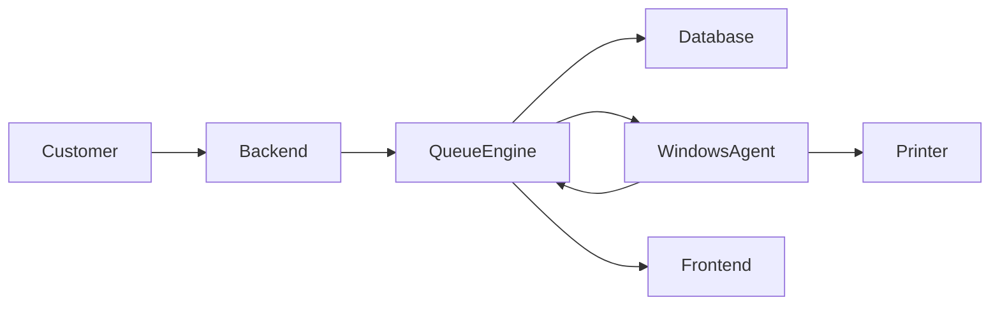
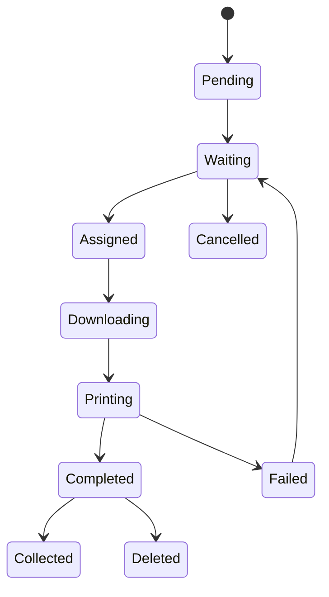
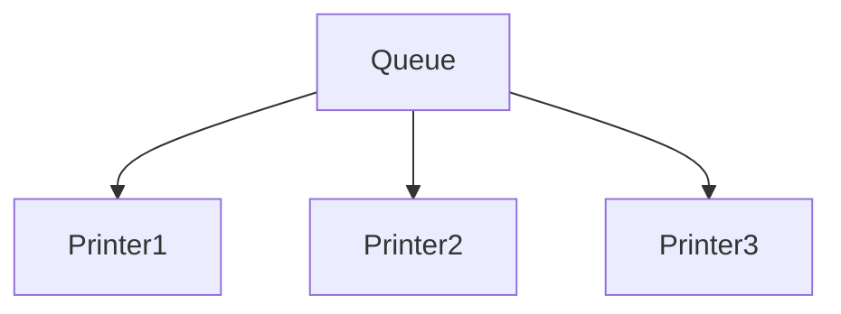

# Queue Engine

Project: Velox

Version: 1.0

Status: Production

Owner: Backend Team

---

# Purpose

The Queue Engine is responsible for managing the lifecycle of every print order.

It ensures:

- Fair order processing
- Accurate ETA
- Correct printer allocation
- Real-time queue updates
- Failure recovery
- Multi-printer synchronization

The Queue Engine is the single source of truth for order processing.

---

# Design Goals

The Queue Engine must be:

- Deterministic
- Fault Tolerant
- Scalable
- Fair
- Predictable
- Easy to Debug

---

# Responsibilities

The Queue Engine shall:

• Accept new print jobs

• Validate payment status

• Assign queue position

• Select the correct printer

• Calculate ETA

• Prevent duplicate jobs

• Handle cancellations

• Retry failed jobs

• Synchronize with Windows Agent

• Notify frontend in real time

---

# Architecture



---

# Order Lifecycle



---

# Order States

Pending

↓

Waiting

↓

Assigned

↓

Downloading

↓

Printing

↓

Completed

↓

Collected

↓

Deleted

---

# State Definitions

## Pending

Order created.

Payment not verified.

Cannot enter queue.

---

## Waiting

Payment successful.

Waiting for printer allocation.

---

## Assigned

Queue Engine selected printer.

Waiting for Windows Agent.

---

## Downloading

Windows Agent downloading document.

---

## Printing

Printer actively printing.

---

## Completed

Printing finished successfully.

Customer notified.

---

## Collected

Customer collected documents.

---

## Deleted

Temporary files removed.

Order archived.

---

## Failed

Printing interrupted.

Needs retry.

---

## Queue Algorithm

Orders are processed using:

FIFO

(First In First Out)

unless overridden by business rules.

---

# Priority Rules

Default Priority

Normal

Future Priorities

VIP

Teacher

Urgent

Bulk

---

# Queue Position

Queue position is NEVER stored permanently.

Instead,

Queue Position is calculated dynamically.

Formula

```
Orders Ahead

WHERE

shop_id = currentShop

AND

status IN (Waiting, Assigned, Downloading, Printing)

AND

created_at < currentOrder
```

This prevents inconsistencies.

---

# ETA Calculation

ETA depends on

Orders Ahead

Printer Speed

Pages Ahead

Current Printer State

Estimated Formula

```
ETA

=

Pages Ahead

÷

Printer Pages Per Minute

+

Buffer Time
```

Buffer

15–30 seconds

Configurable.

---

# Printer Selection

Every printer belongs to one category.

Example

Printer 1

Black & White

Printer 2

Color

Printer 3

Bulk

Selection Rules

Color Job

↓

Color Printer

B&W Job

↓

B&W Printer

Large Job

↓

Bulk Printer

---

# Printer Load Balancing

Future

If multiple printers exist

Choose

Lowest Estimated Completion Time

instead of

First Available.

---

# Multiple Printer Scheduling



Each printer maintains its own internal queue.

---

# Bulk Jobs

Large jobs should not block normal jobs.

Rule

If

Pages > Configured Limit

↓

Move to Bulk Queue

Operator notified.

---

# Cancellation

Allowed

Before

Printing

Not Allowed

After

Printing Started

Reason

Prevent paper wastage.

---

# Retry Strategy

Failures

Paper Empty

↓

Retry

Printer Offline

↓

Retry

Windows Agent Crash

↓

Resume

Download Failure

↓

Retry Download

Maximum Retry Count

3

---

# Duplicate Prevention

Every Order has

UUID

Order Code

Unique Payment

Windows Agent checks

Already Printed?

YES

↓

Ignore

NO

↓

Print

---

# Race Condition Prevention

All queue operations must be atomic.

Use

Database Transactions

or

Row Locks

when assigning printers.

Never allow two agents to claim the same order.

---

# Windows Agent Communication

Queue Engine

↓

Job Assigned

↓

Agent Downloads

↓

Printing

↓

Completed

↓

Status Updated

---

# Queue Refresh

Queue recalculated

After

New Order

Order Cancelled

Printer Completed

Printer Failed

Manual Refresh

---

# Offline Handling

If Agent disconnects

↓

Queue Paused

↓

Reconnect

↓

Resume Automatically

---

# Logging

Every state transition logged.

Example

```
10:30

Order Created

10:31

Payment Success

10:32

Assigned Printer 1

10:33

Printing Started

10:34

Completed

10:35

Collected
```

---

# Notifications

Customer

Payment Successful

↓

Queue Updated

↓

Printing Started

↓

Ready

↓

Collected

Operator

New Job

↓

Printer Offline

↓

Queue Delay

---

# Performance Goals

Queue Assignment

<100ms

ETA

<50ms

Status Update

<1 second

WebSocket Broadcast

<500ms

---

# Future Improvements

Dynamic ETA

AI Queue Optimization

Printer Health Prediction

Automatic Queue Reordering

Smart Printer Assignment

Rush Hour Detection

---

# Engineering Rules

Queue logic exists ONLY in the backend.

Frontend never calculates queue position.

Windows Agent never modifies queue order.

Database is the single source of truth.

---

# Conclusion

The Queue Engine is the heart of Velox.

Its primary objective is to ensure every print job is processed fairly, reliably, and efficiently while maintaining a predictable experience for both customers and shop operators.