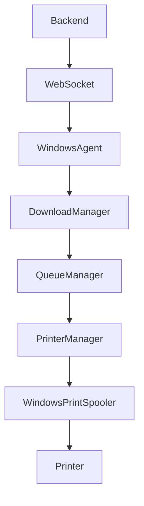

# Windows Agent

Project: Velox

Version: 1.0

Platform: Windows 10 / Windows 11

Framework: .NET 8

Language: C#

Status: Production Specification

---

# Purpose

The Windows Agent is a lightweight desktop service installed on a print shop's Windows computer.

Its responsibility is to securely bridge the Velox Cloud Platform with local printers.

It continuously listens for new print jobs, downloads documents securely, prints them automatically, updates job status, and removes temporary files after successful printing.

The Windows Agent is the only component allowed to communicate directly with printers.

---

# Goals

The Windows Agent must:

• Connect securely to Velox Cloud

• Receive print jobs in real time

• Detect local printers

• Route jobs correctly

• Print automatically

• Report live status

• Recover after failures

• Delete files after printing

• Operate with minimal user interaction

---

# High Level Architecture



---

# Core Modules

```
Windows Agent

├── Authentication
├── Connection Manager
├── Queue Manager
├── Download Manager
├── Printer Manager
├── Print Engine
├── Status Sync
├── Heartbeat Service
├── Configuration
├── Logger
└── Cleanup Service
```

---

# Startup Flow

```mermaid
flowchart TD

Start

-->

Load Config

-->

Authenticate

-->

Connect WebSocket

-->

Discover Printers

-->

Sync Pending Jobs

-->

Ready
```

---

# Authentication

The agent authenticates using:

Shop ID

Device ID

Access Token

After successful authentication:

• Secure token stored locally

• Refresh automatically

• Reauthenticate when required

---

# Connection

Protocol

Secure WebSocket

Responsibilities

Receive new jobs

Receive cancellations

Receive configuration updates

Receive printer assignments

Send heartbeat

Reconnect automatically

---

# Heartbeat

Every

30 seconds

Agent sends:

Agent Status

Version

Printer Status

Queue Length

Last Activity

If heartbeat fails:

Reconnect automatically.

---

# Printer Discovery

On startup

Detect every installed printer.

Collect

Printer Name

Status

Capabilities

Default Paper

Color Support

Print Speed

Supported Sizes

Automatically sync with backend.

---

# Printer Assignment

Every printer belongs to one category.

Examples

Black & White

Color

Bulk

Large Format (Future)

Queue Engine decides which printer receives a job.

---

# Queue Manager

Responsible for

Receiving jobs

Ordering jobs

Retry queue

Cancellation

Failure handling

Queue persistence

The Queue Manager owns the local print queue.

---

# Download Manager

Downloads files securely.

Responsibilities

Verify download

Checksum validation

Temporary storage

File integrity

Resume interrupted downloads

---

# Print Engine

Responsibilities

Open document

Select printer

Configure print options

Silent print

Monitor progress

Update backend

The Print Engine should not display print dialogs.

Printing must be fully automatic.

---

# Status Updates

Possible states

Connected

Downloading

Queued

Printing

Completed

Failed

Offline

These are synchronized with the backend in real time.

---

# Temporary File Storage

Files are stored only during printing.

Location

AppData

↓

Velox

↓

Temp

Files are deleted after successful printing.

---

# Cleanup Service

Automatically removes

Printed files

Failed downloads

Expired cache

Old logs (configurable)

Runs periodically.

---

# Logging

Store

Timestamp

Event

Severity

Message

Examples

Authentication Success

Printer Offline

Download Failed

Printing Started

Printing Completed

Reconnect Attempt

---

# Error Handling

Internet Lost

↓

Reconnect

Printer Offline

↓

Retry

Paper Empty

↓

Pause Queue

↓

Notify Backend

Download Failure

↓

Retry

Application Crash

↓

Recover Queue

↓

Resume

---

# Crash Recovery

If the agent crashes

On restart:

Restore pending queue

Reconnect

Resume incomplete jobs

Never lose a print job.

---

# Configuration

Configurable values

Heartbeat Interval

Retry Count

Download Folder

Auto Delete

Logging Level

Default Printer

Queue Size

---

# Security

HTTPS

Secure WebSocket

Encrypted Tokens

Temporary Storage

Automatic Deletion

Signed Updates

No permanent document storage.

---

# Performance Goals

Startup

<5 seconds

RAM

<150 MB

Idle CPU

<2%

Heartbeat

30 seconds

Reconnect

<10 seconds

---

# Auto Updates

Future

Agent checks for updates.

Downloads

Verifies signature

Installs

Restarts automatically.

---

# Windows Integration

Integrates with

Windows Print Spooler

Windows Services (Future)

System Tray

Windows Notifications

Startup on Boot

---

# Folder Structure

```
windows-agent/

src/

Authentication/

Connection/

Queue/

Download/

Printer/

Printing/

Heartbeat/

Configuration/

Logging/

Utilities/

Program.cs
```

---

# Deployment

Installer

MSIX (preferred)

Future

Silent Installer

Automatic Updates

Group Policy Support

---

# Future Features

Paper Level Detection

Ink/Toner Monitoring

Remote Diagnostics

Printer Health Analytics

Offline Mode

USB Printer Support

Network Printer Support

Linux Agent (Future)

macOS Agent (Future)

---

# Design Principles

The Windows Agent should be:

Invisible

Reliable

Lightweight

Automatic

Secure

Recoverable

Operators should never need to interact with it during normal operation.

---

# Operational Guide & Demo Configuration (Verified in Day 10)

## Configuration Files & Environment Variables

The agent loads configuration in order of precedence:

1. `appsettings.json` (base settings)
2. Environment variables with `VELOX_` prefix
3. Command line arguments

### Key Configuration Settings

- `Agent:ShopId`: Unique UUID of the assigned shop (must match database record)
- `Agent:DeviceId`: Hardware device identity (e.g. `VELOX-DEMO-AGENT-01`)
- `Agent:DeviceKey`: Secret key for device authentication
- `Agent:ApiUrl`: REST API URL (`http://localhost:5000`)
- `Agent:WsUrl`: WebSocket Gateway URL (`http://localhost:5000/agent`)
- `Agent:HeartbeatIntervalSeconds`: `30`

## Authentication & Lifecycle

1. **Login:** Device calls `POST /api/v1/agent/login` with `shopId`, `deviceId`, `deviceKey`.
2. **Token:** Backend validates credentials against `devices` table, issues JWT with `ROLE: AGENT`.
3. **Socket:** Connects to `/agent` namespace with Bearer token, joins room `shop:<shopId>`.
4. **Heartbeat:** Sends `agent.heartbeat` every 30s. Backend marks device `ONLINE` and updates `last_heartbeat`. If heartbeat is missed for >90s, backend flags device `OFFLINE`.
5. **Job Dispatch:** Backend emits `job.assigned` to shop room. Agent processes queue locally via SQLite `agent_queue.db`.
6. **Execution:** Downloads PDF over authenticated streaming endpoint, validates SHA-256 hash against server manifest, configures `PrinterSettings`, and sends GDI document to Windows Print Spooler.
7. **Cleanup:** Local file in `temp/` is shredded immediately upon spool confirmation.

---

# Conclusion

The Windows Agent is the bridge between the Velox cloud platform and local print infrastructure.

It ensures secure, reliable, and automated printing while keeping the customer experience simple and the shop workflow efficient.
